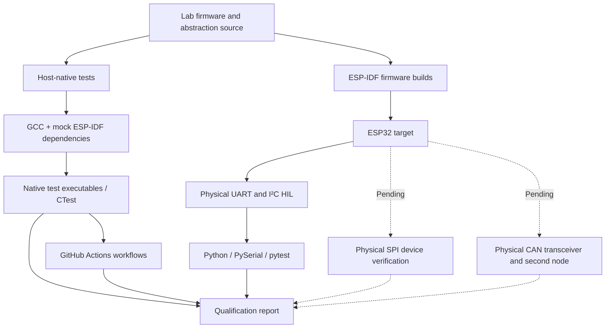

# ESP32 Hardware Interface Labs — Architecture

This document describes **four independent firmware labs**, not one combined ESP32 application. It separates software architecture from the verification environments and identifies physical hardware qualification gaps.

## 1. Firmware architecture

```mermaid
flowchart TB
    subgraph U["Lab 01 — UART"]
      U1["Command protocol"] --> U2["UART bus abstraction"]
      U2 --> U3["ESP-IDF UART driver"]
      U3 --> U4["ESP32 UART / host serial link"]
    end
    subgraph I["Lab 02 — I²C"]
      I1["HIL command protocol / sensor manager"] --> I2["BMP280 driver and I²C bus abstraction"]
      I2 --> I3["ESP-IDF I²C master driver"]
      I3 --> I4["ESP32 GPIO21/22 → BMP280 at 0x76"]
    end
    subgraph S["Lab 03 — SPI"]
      S1["SPI lab logic / BMP280 SPI driver"] --> S2["SPI bus abstraction"]
      S2 --> S3["ESP-IDF SPI master driver"]
      S3 --> S4["ESP32 SPI pins → external SPI device (physical validation pending)"]
    end
    subgraph C["Lab 04 — CAN/TWAI"]
      C1["CAN lab logic"] --> C2["TWAI bus abstraction"]
      C2 --> C3["ESP-IDF TWAI driver"]
      C3 --> C4["ESP32 TWAI controller → transceiver → second node (pending)"]
    end
```

Each lab isolates peripheral-specific operations behind a C abstraction and exercises lifecycle and error-handling behavior. The physical interface differs by lab; native tests do not establish electrical communication.

## 2. Verification and evidence architecture

### Recorded qualification snapshot — 22 October 2026

| Lab | Host-native evidence | Physical evidence |
|---|---|---|
| UART 01 | 11 protocol tests passed | ESP32/host serial exchange verified previously |
| I²C 02 | 3/3 CTest executables passed | BMP280 16/16 HIL cases; SDA disconnect and post-restart recovery |
| SPI 03 | 2/2 CTest executables passed | Pending physical SPI sensor verification |
| CAN/TWAI 04 | 14 native test groups passed | Pending external transceiver and second CAN node |

Native test counts have different granularities (test cases, CTest executables, test groups) and should not be treated as identical units. The I²C coverage figure of 98.7% lines, 95.7% branches, and 100% functions applies only to three instrumented production modules, not the full firmware.

## 3. Key design decisions

1. **Independent labs:** isolate learning and regression scope by peripheral.
2. **Abstraction boundary:** separate application logic from ESP-IDF driver interactions.
3. **Mockable native tests:** exercise argument validation, state transitions, and failure handling without an ESP32 attached.
4. **Physical HIL:** verify real device communication separately from mocked behavior.
5. **Evidence-based qualification:** distinguish verified results from planned hardware tests.

See [Project Qualification Report](PROJECT_QUALIFICATION_REPORT.md) for commands, evidence, and limitations, and [I²C Lab 02 Verification Report](../i2c/lab02_i2c_master/docs/I2C_LAB02_VERIFICATION.md) for the physical BMP280 experiments.
